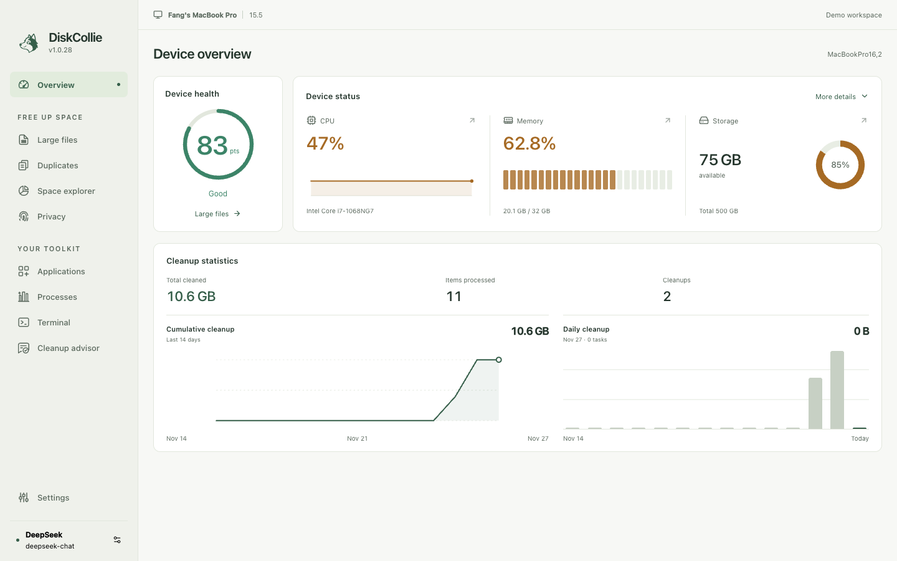
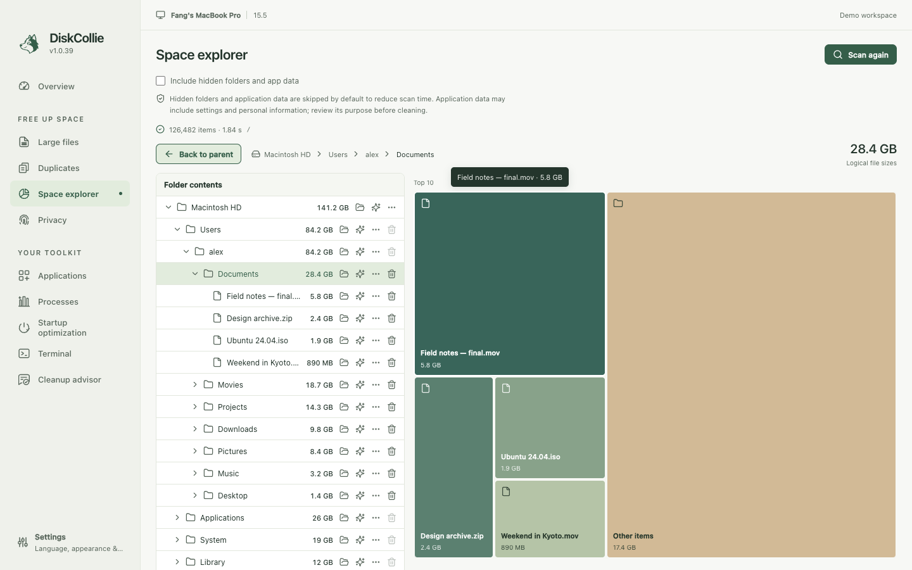
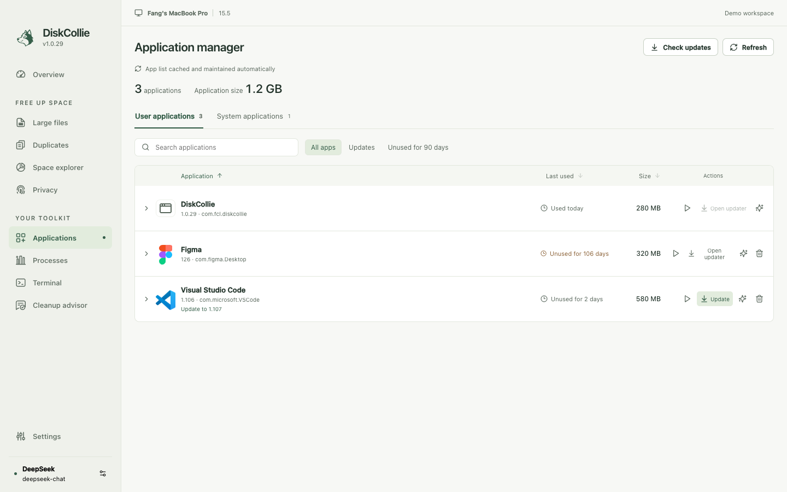

# DiskCollie

See what uses your disk. Review what to clean.

[简体中文](README_ZH.md) · [Latest release](https://github.com/Cailiang/disk-collie/releases/latest)

## Download

| Platform | Download |
| --- | --- |
| macOS | [Apple Silicon](https://github.com/Cailiang/disk-collie/releases/download/v1.0.30/DiskCollie-1.0.30-arm64.dmg) · [Intel](https://github.com/Cailiang/disk-collie/releases/download/v1.0.30/DiskCollie-1.0.30-x64.dmg) |
| Windows | [x64](https://github.com/Cailiang/disk-collie/releases/download/v1.0.30/DiskCollie-1.0.30-x64.exe) · [arm64](https://github.com/Cailiang/disk-collie/releases/download/v1.0.30/DiskCollie-1.0.30-arm64.exe) |
| Linux | x64: [AppImage](https://github.com/Cailiang/disk-collie/releases/download/v1.0.30/DiskCollie-1.0.30-x86_64.AppImage) · [DEB](https://github.com/Cailiang/disk-collie/releases/download/v1.0.30/DiskCollie-1.0.30-amd64.deb) / arm64: [AppImage](https://github.com/Cailiang/disk-collie/releases/download/v1.0.30/DiskCollie-1.0.30-arm64.AppImage) · [DEB](https://github.com/Cailiang/disk-collie/releases/download/v1.0.30/DiskCollie-1.0.30-arm64.deb) |

macOS packages are signed and notarized. [SHA-256 checksums](https://github.com/Cailiang/disk-collie/releases/download/v1.0.30/SHA256SUMS.txt).

## Your device at a glance

## Find where the space goes

## Manage your applications

Screenshots use demo data. Also includes large files, duplicate search, privacy cleanup, app management and an optional AI advisor.

[Feature guide](docs/FEATURES.md) · [Development](docs/LOCAL_AGENT_DEVELOPMENT.md) · [Release process](docs/RELEASING.md) · [Changelog](CHANGELOG.md) · [MIT license](LICENSE)
