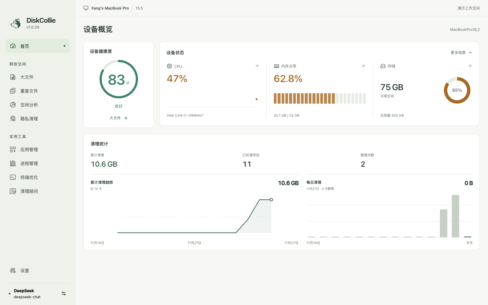
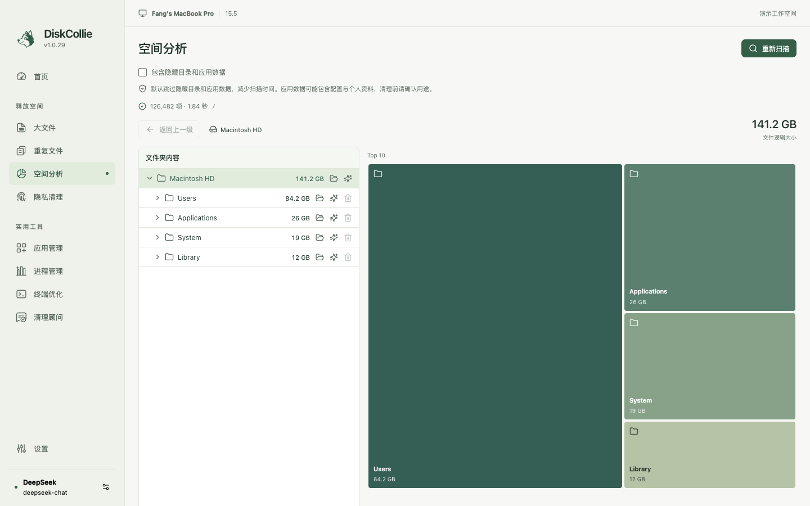
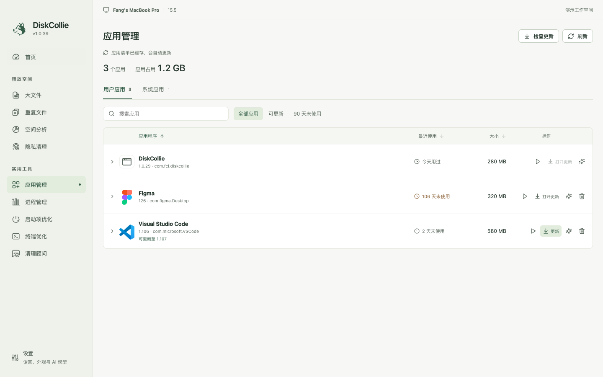
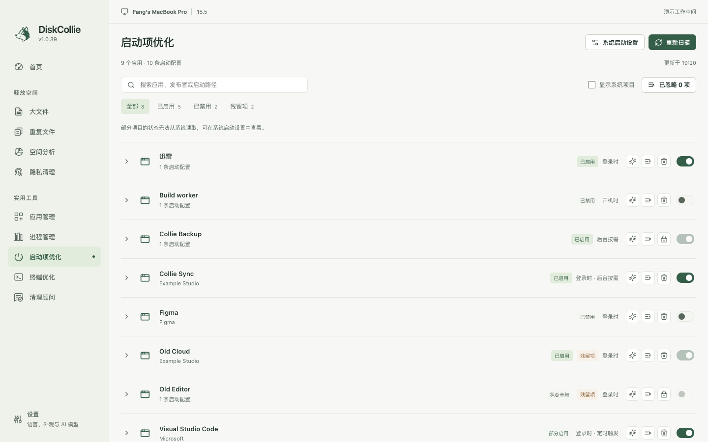

# DiskCollie

看清磁盘占用，核对后再清理。

[English](README.md) · [最新版本](https://github.com/Cailiang/disk-collie/releases/latest)

## 下载

| 平台 | 下载安装包 |
| --- | --- |
| macOS | [Apple 芯片](https://github.com/Cailiang/disk-collie/releases/download/v1.0.39/DiskCollie-1.0.39-arm64.dmg) · [Intel](https://github.com/Cailiang/disk-collie/releases/download/v1.0.39/DiskCollie-1.0.39-x64.dmg) |
| Windows | [x64](https://github.com/Cailiang/disk-collie/releases/download/v1.0.39/DiskCollie-1.0.39-x64.exe) · [arm64](https://github.com/Cailiang/disk-collie/releases/download/v1.0.39/DiskCollie-1.0.39-arm64.exe) |
| Linux | x64: [AppImage](https://github.com/Cailiang/disk-collie/releases/download/v1.0.39/DiskCollie-1.0.39-x86_64.AppImage) · [DEB](https://github.com/Cailiang/disk-collie/releases/download/v1.0.39/DiskCollie-1.0.39-amd64.deb) / arm64: [AppImage](https://github.com/Cailiang/disk-collie/releases/download/v1.0.39/DiskCollie-1.0.39-arm64.AppImage) · [DEB](https://github.com/Cailiang/disk-collie/releases/download/v1.0.39/DiskCollie-1.0.39-arm64.deb) |

macOS 安装包已签名并公证。[SHA-256 校验和](https://github.com/Cailiang/disk-collie/releases/download/v1.0.39/SHA256SUMS.txt)。

## 设备状态，一目了然

## 空间花在哪，看图就知道

## 安装了哪些应用，清楚掌握

## 启动了什么，一眼看清

截图使用演示数据。还支持大文件、重复文件、隐私清理、启动项优化与可选的 AI 清理顾问。

[详细功能](docs/FEATURES_ZH.md) · [开发文档](docs/LOCAL_AGENT_DEVELOPMENT.md) · [发布流程](docs/RELEASING.md) · [更新记录](CHANGELOG.md) · [MIT 许可](LICENSE)
