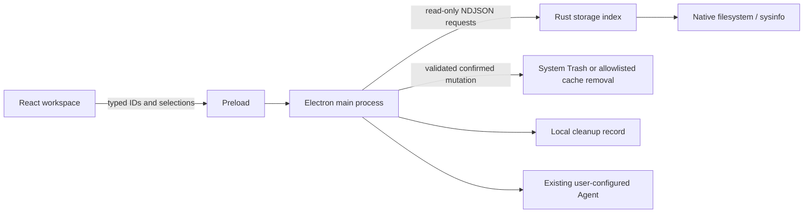

# Cross-platform storage rebuild — 1.0.6

Branch: `rebuild/cross-platform-memento`. The product is organized around freeing storage; process management and the existing user-configured local Agent remain core tools.

## What the MangoDisk research changed

Reference inspected: MangoDisk main `e4d30608faea9527369ee678e6d8ca9a9e1c3688`, release v2.1.1. Its Tauri 2 / Rust / Vue stack separates native storage work from the presentation layer. Useful techniques include bulk directory metadata on macOS, bounded workers, shared navigation/index queries, and staged content hashing. Its user-facing structure puts large files, duplicates, disk analysis, privacy and app associations in clear separate flows. Its homepage makes the outcome of cleaning visible.

Sources: [repository](https://github.com/harry0703/MangoDisk), [release](https://github.com/harry0703/MangoDisk/releases/tag/v2.1.1), [cleanup rules](https://github.com/harry0703/MangoDisk/blob/main/src-tauri/crates/mangodisk-core/rules/README.md), [official site](https://mangodisk.app/zh).

The old Memento homepage concentrated on hardware metrics. It had no dedicated large-file or duplicate flow, a column-only disk browser, no separate privacy module, and bundle-only app removal. Project discovery also exhausted a 160-directory budget before later project roots were reached. Those product and implementation weaknesses motivated this rebuild. The legacy project-discovery budget now accurately names visited directories and allows 20,000; it remains depth-bounded and is used only by the retained macOS Agent evidence scanner.

No source or assets were copied from the GPL project into Memento's MIT codebase. The new native engine, metadata parser, binary treemap and product UI are independent implementations.

## Architecture decision

Keep Electron / React / TypeScript for the desktop boundary, encrypted provider store, AI SDK and safe Agent runtime. Introduce Rust where filesystem work actually happens. A Tauri migration by itself would not make filesystem traversal faster and would require replacing the working Node model integrations. Electron memory/package footprint remains larger than a system-webview shell; this release prioritizes scan latency and coherent product flows over installer size.

`native/` owns traversal, metadata, aggregation, large-file queries and duplicate hashing. One long-lived sidecar retains the current index; large files and folder queries do not scan again. At most four Rayon workers read metadata/hash content. Queries return 100 large files or 200 directory entries at a time. Progress is throttled; cancellation terminates the read-only sidecar and invalidates its index. Scans stop at two million entries with a visible partial-coverage flag. Indexes are memory-resident, never silently reused across app restarts, and explicitly refreshed after mutations.

macOS uses the `getattrlistbulk` ABI defined by Apple's SDK `sys/attr.h`: aligned 64 KiB buffers, bounds-checked records and native metadata. A filesystem or record that cannot supply those attributes falls back to standard traversal. Tests compare size, allocation, identity and timestamps against ordinary metadata and reject truncated/corrupt records. Windows retrieves volume/file identity and link counts through `GetFileInformationByHandle`; Windows reparse/offline/recall attributes are excluded. Unix uses device/inode/link counts; mount crossings, symlinks and macOS dataless cloud files are skipped. The engine does not initiate cloud hydration intentionally. Windows allocation sizes are logical estimates; sparse/compressed sizes and APFS clone/snapshot sharing limit reclaim estimates.

Duplicates are opt-in and compare files ≥1 KiB: equal length, three 8 KiB samples, then complete BLAKE3. Full hashes run only for sample collisions. The main process rejects deletion of every copy and rehashes the survivor and selected copies immediately before moving them. A separate test puts a difference outside every sample and verifies that full hashing rejects it.

## Product design

Warm neutral surfaces, forest-green actions, consistent Lucide icons, restrained color accents and a persistent grouped sidebar. No full-home scan on launch. Homepage shows available disk capacity, task shortcuts and recent activity. Detailed lists start with no selection; clear review dialogs explain permanent cache removal versus reversible Trash operations. System/application-data paths cannot be removed through large-file browsing. Treemap and folder-list controls provide the same navigation, with breadcrumb return paths. Reduced-motion preferences and keyboard focus/dialog trapping are supported. Layouts are checked at 1440×900, 1024×768, 820×1180 and 390×844.

## Capability matrix

| Capability | macOS | Windows | Linux |
| --- | --- | --- | --- |
| Home / persistent cleanup history | Implemented | Implemented | Implemented |
| Directory index / large files / treemap | Bulk metadata + fallback | Native traversal / file IDs | Native traversal / inode IDs |
| Duplicate content verification | Implemented | Implemented | Implemented |
| Personal files to system Trash | Electron shell | Electron shell | Desktop Trash service required |
| Cache rules | npm/Yarn/Gradle/Cargo/pip/Homebrew/Xcode/browser/logs | npm/Yarn/Gradle/Cargo/pip/browser | npm/Yarn/Gradle/Cargo/pip/browser |
| Privacy | Safari/Chrome/Edge default history | Chrome/Edge default history | Chrome/Chromium history / recent documents |
| App inventory | Bundles in application roots | Uninstall registry entries | Desktop application entries |
| Uninstall | Bundle + optional related files to Trash | Opens Windows Apps & Features | Opens OS software manager via AppStream |
| App associations | Exact bundle ID + explicit product mapping; no shared groups | System uninstaller owns data decisions | System package manager owns data decisions |
| Live process metrics / user process control | Existing native OS integration | Rust sysinfo | Rust sysinfo |
| Existing configurable AI and provider encryption | Preserved | Preserved + portable evidence | Preserved + portable evidence |
| Terminal / startup/service internals | Preserved | Not offered as native fixes | Not offered as native fixes |
| Local runtime validation in this work | Verified x64 | Compile check only | CI configured, not run locally |

Platform packaging is configured for x64 and arm64 on all three systems. `beforePack` compiles the Rust binary for the **package architecture**, and resources contain the matching executable and `source-revision.json`. CI runs native tests, JS tests, a production build, native smoke and real Electron smoke on three operating systems. Release collection now expects all six platform/architecture jobs, eight installers and the corresponding update payloads/manifests, with eight installer hashes. No public release was requested or published during this rebuild.

Windows verification runs the portable product tests; seven retained macOS maintenance test files (Finder Trash fallback, Homebrew, legacy `du`, hidden-home maintenance, privileged AppleScript, shell environment and launch services) run on the POSIX runners. Mac application-root classification and POSIX permission-bit assertions are also platform scoped. AI encryption, provider editing, path evidence, native indexing and real Trash operations remain covered on Windows. Local Agent evidence accepts both home-path separators and inspects the platform's application-data roots.

Windows/Linux package-manager handoff is intentional: deleting installation folders directly would bypass uninstall registrations, services and package databases. Linux requires a desktop handler for `appstream://`; absent handlers report an error instead of claiming success. Browser histories beyond supported default profiles are not yet enumerated. No package-manager removal or Windows/Linux runtime result is claimed as verified by the local macOS session.

## Mutation and recovery boundaries

The Renderer cannot supply a root path for mutation. It can ask for the system directory picker or the home directory, then use numeric entries paired with the current generation. Main validates all IPC schemas, checks index generation and obtains authoritative entries from Rust. File identity, size, timestamp and non-link path components are rechecked. App bundles and related paths are registered in main, with associated data unselected by default. Shared app containers and fuzzy name matches are excluded; explicit known product folders are included only for their exact bundle IDs.

Caches and supported history records are permanently deleted after confirmation. Privacy groups include existing SQLite `-wal`, `-shm` and `-journal` sidecars, and refuse to run while the browser is detected. Files/apps move to Trash through Electron, preserving OS recovery. The main process journals attempted tasks before changes, persists after each item and distinguishes failures. Bytes are processed-content estimates; Trash remains allocated until emptied. Path revalidation narrows races but does not provide a kernel-level transactional Trash operation; Electron's path-based Trash API is the boundary.

The existing macOS Agent scanner remains an on-demand evidence source for service and terminal operations, including provider-specific app-update internals. It is not used for new storage-page scans. The old scanner can take significantly longer than the focused native index; that timing must not be presented as the native storage engine timing.

## Languages

`src/shared/localization.ts` owns the locale registry and English fallback; `src/shared/locales/` owns flat message resources. The new workspace uses semantic keys. 584 static/interpolated messages from the existing AI/settings/maintenance views were extracted into catalog keys; dynamic legacy OS diagnostics still use their existing Chinese/English compatibility formatter. The settings selector and `AppLanguage` derive from the registry. Add a language resource, register it and provide matching placeholders; parity tests catch missing keys. Dates/numbers use `Intl`. Any new dynamic diagnostic should use catalog interpolation rather than adding bilingual branches.

## Evidence from this machine

- Native tests: metadata ABI parity, corrupt record rejection, changed-file rejection, hard-link/symlink exclusion and full-hash rejection of sample collisions.
- macOS x64 synthetic warm-cache fixture: 20,103 entries (20,000 small files plus directories and two 1 MiB copies). One observed run: standard native enumeration **37 ms**, bulk native enumeration **25 ms**. A previous more loaded run measured 97/66 ms. This is a repeatable local engine comparison, **not** a competitor or whole-disk benchmark. Run `node scripts/native-smoke.mjs` after building.
- Real macOS home-directory scan: **2,000,000 entries in 61.4 seconds**, 61,648 skipped entries, no enumeration errors, and the entry limit reached. This is partial coverage of a large developer home directory, not a complete disk result. The UI reports the limit; choosing a smaller folder provides complete coverage there. The small fixture timing must not be generalized into a claim that million-entry scans finish instantly.
- Existing macOS Agent scan smoke: ~16.4–20.2 seconds on this machine, with valid registered operations and no scan diagnostics. This is broader evidence collection including service, shell and application-update discovery, not a comparable index workload.
- Real Electron smoke: actual local metrics/inventory, native index and duplicate grouping; main-process all-copies guard; cancellation; one owned fixture moved to Trash; persisted record; privacy selection; encrypted provider key edit/test/save/reload.
- Browser UI: 48 page captures across four viewports plus confirmation interactions, duplicate survivor selection, app association selection, process-to-AI flow, English and dark mode. No page errors or horizontal overflow.
- Windows x64 Rust `cargo check` completed locally. Windows/Linux runtime and signed public release remain CI validation boundaries.
