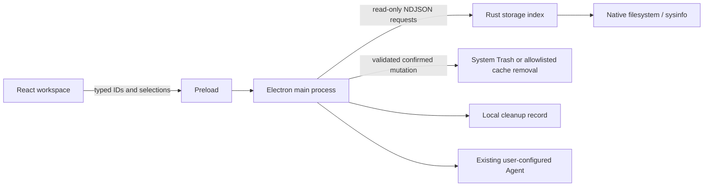

# DiskCollie cross-platform storage workspace — 1.0.24

Repository: [Cailiang/disk-collie](https://github.com/Cailiang/disk-collie), branch `main`. The product is organized around freeing storage; process management and the existing user-configured local Agent remain core tools.

## DiskCollie identity and profile migration — 1.0.24

The product/package/bundle/native identities are DiskCollie, `disk-collie`, `com.fcl.diskcollie` and `disk-collie-engine`. The Renderer bridge is `window.diskCollie`, IPC uses `diskcollie:`, build/test environment variables use `DISKCOLLIE_`, and the updater, issue/security links, release collector and workflows target the new repository. Installer names use DiskCollie on every platform. Cached build resources remove the old native executable before packaging.

Default profiles use the platform application-data directory plus `DiskCollie`. Before opening stores, first launch copies managed data from a legacy Memento/memento profile. `profile-migration.ts` snapshots SQLite with VACUUM INTO (including committed WAL data), stages the original 32-byte provider key and legacy JSON files with private permissions, and publishes complete files exclusively, database last. Failures roll back only newly installed files; a matching already-published key permits retry. Existing new databases and conflicting keys are never overwritten; custom profile paths are never redirected. Both stores recognize an old database filename in a selected profile. Fixture coverage verifies decryption, settings, cleanup totals, WAL rows, retry, missing keys, existing data and JSON-only migration. Legacy protected directories, terminal markers and game-score keys remain intentional compatibility strings. Historical release entries keep their original names.

The old GitHub repository is retired with a migration notice and archived after the new main branch is verified. Source history and the new repository's initial license commit are retained. Moving source does not publish a release tag; public packages still require the signed/notarized workflow described in RELEASING.md.

Exclusion comparison normalizes drive/UNC namespace prefixes, separators and casing on Windows, with directory-pruning fixtures and a portable normalization regression test. Other platforms retain their path semantics.

## What the MangoDisk research changed

Reference inspected: MangoDisk main `e4d30608faea9527369ee678e6d8ca9a9e1c3688`, release v2.1.1. Its Tauri 2 / Rust / Vue stack separates native storage work from the presentation layer. Useful techniques include bulk directory metadata on macOS, bounded workers, shared navigation/index queries, and staged content hashing. Its user-facing structure puts large files, duplicates, disk analysis, privacy and app associations in clear separate flows. Its homepage makes the outcome of cleaning visible.

Sources: [repository](https://github.com/harry0703/MangoDisk), [release](https://github.com/harry0703/MangoDisk/releases/tag/v2.1.1), [cleanup rules](https://github.com/harry0703/MangoDisk/blob/main/src-tauri/crates/mangodisk-core/rules/README.md), [official site](https://mangodisk.app/zh).

The old DiskCollie homepage concentrated on hardware metrics. It had no dedicated large-file or duplicate flow, a column-only disk browser, no separate privacy module, and bundle-only app removal. Project discovery also exhausted a 160-directory budget before later project roots were reached. Those product and implementation weaknesses motivated this rebuild. The legacy project-discovery budget now accurately names visited directories and allows 20,000; it remains depth-bounded and is used only by the retained macOS Agent evidence scanner.

No source or assets were copied from the GPL project into DiskCollie's MIT codebase. The new native engine, metadata parser, binary treemap and product UI are independent implementations.

## Architecture decision

Keep Electron / React / TypeScript for the desktop boundary, encrypted provider store, AI SDK and safe Agent runtime. Introduce Rust where filesystem work actually happens. A Tauri migration by itself would not make filesystem traversal faster and would require replacing the working Node model integrations. Electron memory/package footprint remains larger than a system-webview shell; this release prioritizes scan latency and coherent product flows over installer size.

`native/` owns traversal, metadata, aggregation, large-file queries and duplicate hashing. Each scan purpose (large files, duplicates, analysis) retains its own long-lived sidecar and index. Filtering and directory queries reuse the matching session. Switching pages preserves results, filters, selections and directory position. Rescanning replaces only that purpose after success; cancelling a replacement keeps the previous session. Each index sidecar uses at most four Rayon workers for metadata/hash content; the scheduler caps heavy index/hash work at two jobs. Queries return 100 large files or 200 directory entries at a time. Progress is throttled; cancellation terminates only the active read-only sidecar. The two-million-entry cutoff is removed. Compact records store parent/name and numeric identities; full paths are reconstructed only for I/O and visible results. Linked child indexes avoid whole-index navigation queries; a deque avoids shifting the traversal queue. Large-file and duplicate scans retain only directories and eligible file candidates; skipped small-file sizes still contribute to directory totals. Only multiply linked files enter the physical-alias set. Indexes are memory-resident, never silently reused across app restarts, and reconciled after confirmed mutations: successful paths are removed with stable IDs and corrected ancestor totals; other results remain queryable.

macOS uses the `getattrlistbulk` ABI defined by Apple's SDK `sys/attr.h`: aligned 64 KiB buffers, bounds-checked records and native metadata. A filesystem or record that cannot supply those attributes falls back to standard traversal. Tests compare size, allocation, identity and timestamps against ordinary metadata and reject truncated/corrupt records. Windows retrieves volume/file identity and link counts through `GetFileInformationByHandle`; Windows reparse/offline/recall attributes are excluded. Unix uses device/inode/link counts; mount crossings, symlinks and macOS dataless cloud files are skipped. The engine does not initiate cloud hydration intentionally. Windows allocation sizes are logical estimates; sparse/compressed sizes and APFS clone/snapshot sharing limit reclaim estimates.

Duplicate scans default to and enforce a minimum of files ≥10 MiB at the product IPC boundary: equal length, three 16 KiB samples, then complete BLAKE3 with 1 MiB reads. All three file workspaces scan the system drive, with no folder picker. All file workspaces skip hidden descendant directories by default. Large-file/duplicate cleanup always excludes protected system roots, application data, credentials and Trash; its option includes only hidden personal directories. Analysis may explicitly include application data for read-only inspection. macOS protects home Library and system/application roots; Windows protects AppData, configured roaming/local data, ProgramData and installed-system roots; Linux protects configuration/data and system roots. Native exclusions are canonicalized, including temporary-directory aliases. Retained indexes store the actual include option. Space totals reflect the selected scope. UI settings are passed to native traversal. A bounded in-session identity/size/mtime hash cache speeds repeat queries; no hashes persist across app restarts. Files modified within four seconds (or dated in the future) bypass cache reads to handle coarse filesystem clocks; tests rewrite equal-size content while restoring its exact timestamp. Discovery checks descriptor metadata without repeatedly statting all ancestors; mutation bypasses caches and preserves full path validation. Hash progress reports completed/total files at 120 ms intervals. Full hashes run only for sample collisions. The main process rejects deletion of every copy in any selected group and rehashes every survivor and selected copy before moving any file in the whole batch. A shared bottom action bar reviews cross-group selections, count/size and group count in one confirmation; large-file, cache/privacy actions use the same bar. The AI task launcher is in the top bar. A separate test puts a difference outside every sample and verifies that full hashing rejects it.

## Product design

Warm neutral surfaces, forest-green actions, a consistent family of semantic navigation icons, restrained color accents and a persistent grouped sidebar. No full-home scan on launch. Homepage presents a weighted health score from available CPU/GPU/memory/storage/battery readings (missing measurements excluded), a CPU sample line, segmented memory bar and storage ring in one compact panel with expandable GPU/power/network details. Cards enter CPU/memory descending user-process lists or large files. The visible score and ring use green ≥80, amber 50–79, red <50; repeated dimensions, method explanation and slogans are removed from the homepage. Immediate total organized bytes, a 14-day cumulative line and daily bars show per-day task counts. The cumulative line includes lifetime activity before the displayed window. The full local ledger is retained; only successful item bytes count. All successful cleanup bytes share a cumulative statistic; processed bytes are never described as newly free disk space. The duplicated recent list is removed. File, duplicate, directory, cleanup/privacy path and application association rows expose registered Show in folder and metadata-based Ask AI with a return to their source page. Cleanup animates actual completed-item counts and current paths, then returns to the remaining results; failed selections remain reviewable. Detailed lists start with no selection; clear review dialogs explain permanent cache removal versus reversible Trash operations. System/application-data paths cannot be removed through large-file browsing. The directory tree is on the left and the treemap on the right, with breadcrumb return paths. System-drive analysis includes Users and ordinary APFS firmlinks, avoids System/Volumes alias traversal and counts directory identities once. Large files have file-type filters; duplicates expand type → group → copies; privacy expands category → application (OS icon) → profile → record → paths; the application manager lives under Utilities, separates User/System tabs with User as the default and shows real OS logos, measured sizes, true usage metadata (without mtime substitution), search, sortable column headers, unused/update filters, Open, Update and Ask AI. Inline uninstall details label rebuildable versus personal data and permit registered child inspection/selection. The complete app bundle remains required; overlapping parent/child jobs count once. Process rows restore lazy logos, sortable name/PID/CPU/memory headers, user/system scope and inline actions. Help is a small transparent glyph only where its explanation is useful; Overview, Applications, Processes, History and Space explorer omit redundant help. Space explorer has an explicit parent button and a Top 10 + Other projection. Other opens later groups and fetches additional directory pages. Minimum pixel bounds (80×56 where the container permits) keep names/bytes visible; geometry is deliberately adjusted and byte labels remain authoritative. A tooltip explains the projection; the independent smaller-item list is removed. Reduced-motion preferences and keyboard focus/dialog trapping are supported. Layouts are checked at 1440×900, 1024×768, 820×1180 and 390×844.

## Capability matrix

| Capability | macOS | Windows | Linux |
| --- | --- | --- | --- |
| Home / persistent cleanup history | Implemented | Implemented | Implemented |
| Directory index / large files / treemap | Bulk metadata + fallback | Native traversal / file IDs | Native traversal / inode IDs |
| Duplicate content verification | Implemented | Implemented | Implemented |
| Personal files to system Trash | Electron shell | Electron shell | Desktop Trash service required |
| Cache rules | npm/Yarn/Gradle/Cargo/pip/Homebrew/Xcode/browser/logs | npm/Yarn/Gradle/Cargo/pip/browser | npm/Yarn/Gradle/Cargo/pip/browser |
| Privacy | Chromium/Firefox records, Safari history/sessions/cache, SFL2/3/4 + Finder + shell + clipboard summary, scoped app activity | Chromium/Firefox records, explicit Recent shortcuts and scoped app data | Chromium/Firefox records, XBEL recents, shell and scoped app data |
| App inventory | Bundles in application roots | Uninstall registry entries | Desktop application entries |
| Application management | Local metadata, Open, Homebrew/App Store/Sparkle updates, bundle + selected registered descendants to Trash | Opens Windows Apps & Features | Opens OS software manager via AppStream |
| App associations | Exact bundle ID + explicit product mapping; no shared groups | System uninstaller owns data decisions | System package manager owns data decisions |
| Live process metrics / user process control | Existing native OS integration | Rust sysinfo | Rust sysinfo |
| Existing configurable AI and provider encryption | Preserved | Preserved + portable evidence | Preserved + portable evidence |
| Terminal / startup/service internals | Preserved | Not offered as native fixes | Not offered as native fixes |
| Local runtime validation in this work | Verified x64 | Compile check only | CI configured, not run locally |

Platform packaging is configured for x64 and arm64 on all three systems. `beforePack` compiles the Rust binary for the **package architecture**, and resources contain the matching executable and `source-revision.json`. CI runs native tests, JS tests, a production build, native smoke and real Electron smoke on three operating systems. Release collection now expects all six platform/architecture jobs, eight installers and the corresponding update payloads/manifests, with eight installer hashes. No public release was requested or published during this rebuild.

Windows verification runs the portable product tests; seven retained macOS maintenance test files (Finder Trash fallback, Homebrew, legacy `du`, hidden-home maintenance, privileged AppleScript, shell environment and launch services) run on the POSIX runners. Mac application-root classification and POSIX permission-bit assertions are also platform scoped. AI encryption, provider editing, path evidence, native indexing and real Trash operations remain covered on Windows. Local Agent evidence accepts both home-path separators and inspects the platform's application-data roots.

Windows/Linux package-manager handoff is intentional: deleting installation folders directly would bypass uninstall registrations, services and package databases. Linux requires a desktop handler for `appstream://`; absent handlers report an error instead of claiming success. Chromium discovery enumerates real profiles for Chrome, Edge, Brave, Chromium, Opera, Vivaldi, Yandex, QQ/360 and macOS Arc. Firefox profiles use their own schema adapters. Safari has history/session/cache support; separate Safari search/download/account stores are not claimed. Windows system activity currently handles explicit Recent shortcuts, not Jump Lists, registry or clipboard history. No Windows/Linux runtime result is claimed as verified by the local macOS session.

## Mutation and recovery boundaries

The Renderer cannot supply a root path for mutation. It can request a system-drive scan, then use numeric entries paired with the matching purpose’s generation. Main validates all IPC schemas, checks index generation and obtains authoritative entries from Rust. File identity, size, timestamp and non-link path components are rechecked. App bundles and related paths are registered in main, with associated data unselected by default. Shared app containers and fuzzy name matches are excluded; explicit known product folders are included only for their exact bundle IDs.

Caches and supported history records are permanently deleted after confirmation. Privacy uses selective SQLite transactions; it never deletes whole database/sidecar sets to clear a logical record type. A running browser must be closed or explicitly skipped. Files/apps move to Trash through Electron, preserving OS recovery. The main process journals attempted tasks before changes, persists after each item and distinguishes failures. Bytes are processed-content estimates; Trash remains allocated until emptied. Path revalidation narrows races but does not provide a kernel-level transactional Trash operation; Electron's path-based Trash API is the boundary.

The existing macOS Agent scanner remains an on-demand evidence source for service and terminal operations, including provider-specific app-update internals. It is not used for new storage-page scans. The old scanner can take significantly longer than the focused native index; that timing must not be presented as the native storage engine timing.

## Application management — 1.0.9

Application inventory is local and does not wait on update services. Reused deterministic metadata and update adapters live in `scanner.ts`; no old Renderer or hosted services are restored. `StorageService` owns separate application IDs, metadata, update registrations and file snapshots. Portable AI evidence reuses current application/cache registrations so an explanation cannot expire selections in the original page. Check updates queries the existing sources; execution accepts only a registered ID, validates tokens and uses the existing Sparkle identity/signature verifier. External updater handoffs return `opened`, not `updated`. Linux uses registered desktop launch entries/theme icons; Windows uses registered executable icons when available. Missing platform usage data remains unknown.

The uninstall detail reference was inspected from [MangoDisk’s official screenshot](https://assets.mangodisk.app/images/screenshots/zh/light-04-app-uninstaller.jpg?ver=2.1.1). The independent implementation follows the visible path/size/risk labeling idea; no MangoDisk source or assets were incorporated.

## Background work and process controls — 1.0.10

`StorageTaskQueue` runs independent scopes concurrently. Same-scope jobs remain ordered; all mutations are mutually exclusive, and at most two heavy file scans/hash jobs run concurrently. Privacy/cache discovery use dedicated sidecars and can run/clean during file scanning. Successful mutations record paths against active scans; those scans forget the paths before publishing. Existing hash sessions keep removal tombstones and filter their reply while queued index reconciliation completes. Progress carries its originating scope; pages show queued state and cancellation targets only their own scope. Pending cancellation removes the job without stopping active work. Job errors do not poison the queue; no navigation waits on a global busy rejection.

`AiTasks.tsx` owns session-local explanation tasks: needs-provider → queued → preparing → running → ready/failed/cancelled. A single explanation starts at a time, duplicate clicks reuse the task, completion events arriving before the start response are buffered, and cancellation signals both preparation and native runs. Asking never changes pages automatically. The panel tracks unread results, shows progress/success on the originating action and supports retry/dismissal. Provider setup retains the source/scroll and saved configuration resumes waiting tasks. Viewing a result retains a return to the source; process filters remain mounted. Completed runs still use the existing history/runtime. A measured portal tooltip supports hover/focus without clipping or fixed-width edge offsets. Task access is in the top bar, with an anchored panel that closes on outside click/Escape; completion never opens the panel automatically.

Processes default to user-only, CPU descending; CPU and memory use strict >40% orange / >65% red boundaries. Rows freeze during pointer/focus interaction. macOS `process-control.ts` resolves the owning outer app bundle, terminates all owned bundle processes for force quit, checks UID/path/start identity, protects system/self/ancestor processes and polls actual exit. Normal quit targets main app executables. Restarted/still-running apps report failure. Portable native termination also verifies PID/start-time disappearance. A pinned Dock shortcut can remain after process exit.

## Progressive application inventory — 1.0.11

Startup restores a schema-validated, platform-scoped `application-inventory.json` and starts discovery independently from page navigation. The Renderer subscribes to typed inventory snapshots, shows cached/partial rows immediately and retains them during refresh/failure. macOS inspects metadata in batches of eight without recursive `du` fallback, then measures non-system bundle sizes on a separate sidecar with an eight-second per-bundle timeout. List readiness does not wait on size measurement. Directory/Info.plist identity, modification times and version fingerprint size reuse; unchanged apps are not recursively measured again.

Root watchers debounce install/removal events and a five-minute refresh updates external changes and use metadata. IDs remain stable by location (plus name for shared Windows registry locations). Changes invalidate only their affected update/association registrations; confirmed app removal persists immediately. Disk writes serialize atomic replacement. Persisted records are display data and require live re-registration before Open/Update/Uninstall; cached updater authorizations are never restored. First reads/refreshes coalesce, including startup; an empty or failed cache falls back to discovery with visible retry. Directory watchers are opportunistic, with periodic discovery as fallback. No persistent storage-file index is introduced.

## Layered privacy and design references — 1.0.12

The earlier file-only privacy registry is superseded by the 1.0.15 record adapters described below. `PrivacyWorkspace.tsx` retains the four source categories with real OS icons and profile/type hierarchy, and opens paginated local previews instead of a path-only list.

Visual reference inspected from MangoDisk’s official [overview image](https://assets.mangodisk.app/images/screenshots/zh/light-00-overview.jpg?ver=2.1.1), [privacy image](https://assets.mangodisk.app/images/screenshots/zh/light-09-privacy-cleanup.jpg?ver=2.1.1) and [privacy guide](https://mangodisk.app/zh/docs/features/privacy-cleanup). The requested grouping/compact layout informed independent code; no source or assets were copied. Browser-preview icons are local vector fixtures; production uses registered OS application icons when available.

## Languages

`src/shared/localization.ts` owns the locale registry and English fallback; `src/shared/locales/` owns flat message resources. The new workspace uses semantic keys. 584 static/interpolated messages from the existing AI/settings/maintenance views were extracted into catalog keys; dynamic legacy OS diagnostics still use their existing Chinese/English compatibility formatter. The settings selector and `AppLanguage` derive from the registry. Add a language resource, register it and provide matching placeholders; parity tests catch missing keys. Dates/numbers use `Intl`. Any new dynamic diagnostic should use catalog interpolation rather than adding bilingual branches.

## Evidence from this machine

- Native tests: metadata ABI parity, corrupt record rejection, changed-file rejection, hard-link/symlink exclusion, full-hash rejection of sample collisions, projection totals/hidden scope, cached-content invalidation and category/pagination correctness.
- macOS x64 synthetic warm-cache fixture: 20,103 entries (20,000 small files plus directories and two 1 MiB copies). One observed run: standard native enumeration **37 ms**, bulk native enumeration **25 ms**. A previous more loaded run measured 97/66 ms. This is a repeatable local engine comparison, **not** a competitor or whole-disk benchmark. Run `node scripts/native-smoke.mjs` after building.
- Previous 1.0.6 home scan stopped at **2,000,000 entries / 61.4 s**. 1.0.7 full home analysis enumerated **2,131,920 / 60.773 s**, zero errors, 62,013 skipped; no cutoff. This confirms coverage beyond the old cap, not a major full-traversal speedup.
- 1.0.7 focused large-file scope: **525,197 enumerated entries / 8.148 s**, 66,818 retained records, zero errors, 12,004 skipped. Full hidden/app-data coverage requires the visible include option.
- 1.0.7 default duplicate scope: **524,692 enumerated entries**, 76,010 retained records, **9.431 s traversal + 3.240 s content verification = 12.698 s total**; 816 duplicate groups. Repeating the query in the same session took **38 ms**. This uses the exposed ≥200 KB, hidden/app-data exclusions; it is not equivalent to a full-home scan or a controlled competitor benchmark.
- Read-only system-drive analysis enumerated **3,682,623 entries / 99.773 s**, 309 inaccessible directories, 171,706 skipped; no cutoff. **Users was the largest root child (321,970,497,592 logical bytes)**. Full-disk traversal remains materially slower than focused duplicate discovery. APFS sharing and skipped paths limit totals.
- Reproduce read-only workloads with `node scripts/storage-benchmark.mjs <root> analysis|large|duplicates`.
- Existing macOS Agent scan smoke: ~16.4–20.2 seconds on this machine, with valid registered operations and no scan diagnostics. This is broader evidence collection including service, shell and application-update discovery, not a comparable index workload.
- Real Electron smoke: application inventory starts without page navigation, persists and restores stable IDs after restart; cross-group duplicate removal on owned fixtures; independent file/privacy discovery, owned child process exits through production IPC, actual local metrics/inventory, native index and duplicate grouping; main-process all-copies guard; cancellation; one owned fixture moved to Trash; persisted record; privacy selection; encrypted provider key edit/test/save/reload.
- Browser UI: 48 page captures across four viewports plus cleanup animation/remaining-results flows, retained filters/selections, immediate home totals and charts, AI background/unread/provider-setup/return/cancel/retry flows, duplicate survivor selection, app association selection, process-to-AI flow, English and dark mode. No page errors or horizontal overflow.
- Windows x64 Rust `cargo check` completed locally. Windows/Linux runtime and signed public release remain CI validation boundaries.

## 1.0.13 interaction and storage updates

Scan status labels now identify the active workspace rather than using the explorer's mapping text everywhere. Explorer file rows add reviewed Trash actions using the analysis session, native identity validation, personal-file path policy and the same cross-index reconciliation as other removals; directories remain read-only.

Overview removes its duplicated recent list. All successful cleanup bytes contribute to one cumulative total and the daily/cumulative charts immediately, with separate item and session counts. The product does not infer later user actions in the OS Trash.

`StorageLedger` stores `cleanup_activity` in the same WAL-enabled `disk-collie.sqlite` file as providers and `app_settings`. It upserts progress before/after item operations. A transactional `local_migrations` marker imports valid legacy `storage-history.json` once, preserves the original file and never overwrites newer records. A malformed legacy file remains available for later recovery. Provider secrets remain AES-256-GCM encrypted; application inventory JSON is a disposable presentation cache.

Application manager uses separate User/System tabs and bidirectional sortable Name/Last used/Size headers, with unknown usage dates last in either direction. System applications have Open/Ask AI but no uninstall control, and the main process rejects their uninstall. macOS logos come from configured bundle ICNS artwork converted locally to PNG, with bounded concurrent reads and an OS fallback. Cached rows retry artwork after live registration. Uninstall inspection always registers a readable application bundle independent of recursive size measurement; associated-data measurement has an eight-second bound. No associated files is a supported app-only uninstall state, while an unreadable app itself produces a retryable message.

## Cleanup scope and visible notices — 1.0.14

Large-file/duplicate scans use `storageProtectedPaths` and `storageProtectedNames`, the same rules as mutation validation. `/private` (including `/private/var`), system/application roots, app data, credential directories and Trash are pruned before traversal and hashing, even when hidden personal directories are included. Native exclusions apply to both files and directories. Exploration retains its read-only purpose: Main annotates child entries with non-authoritative `trashable` metadata and the Renderer disables protected delete controls with an explanation. Main still validates every selection independently. Protected locations are a product safety boundary; this path does not request elevated deletion privileges.

`MessageProvider` owns a global FIFO of operation notices. Identical pending messages deduplicate, notifications render outside hidden page containers as centered alert dialogs, and remain until acknowledged or dismissed with Escape. Success/error notices no longer rely on a page-top strip or timed toast. Focus is trapped only by the top dialog and restored on close. Scan/progress status remains inline. A changed-file rejection is localized and leaves the indexed results and source file intact until a rescan.

Reference: [Apple File System Basics](https://developer.apple.com/library/archive/documentation/FileManagement/Conceptual/FileSystemProgrammingGuide/FileSystemOverview/FileSystemOverview.html). `/var` contains changing system data, including logs; matching duplicate bytes is not sufficient evidence that an arbitrary item can be deleted. Known disposable data remains the responsibility of narrow cleanup rules rather than the generic file deduplicator.

Coverage exercises protected-tree pruning before hashing, hidden-directory inclusion without bypassing protection, read-only analysis actions, modal placement at all four viewports, provider/app operation notices, and an actual changed-file rejection/rescan/delete flow on owned Electron fixtures.

## Record-based privacy and explorer actions — 1.0.15

Reference behavior: MangoDisk 2.1.1, tag commit `d2a4fd6597524eb77b0687cfe1c9e6f533fae7c9`, official [privacy guide](https://mangodisk.app/zh/docs/features/privacy-cleanup), versioned [models](https://github.com/harry0703/MangoDisk/blob/v2.1.1/src-tauri/crates/mangodisk-core/src/privacy/models.rs), [browser schema](https://github.com/harry0703/MangoDisk/blob/v2.1.1/src-tauri/crates/mangodisk-core/src/privacy/browser_database/schema.rs) and [macOS adapter](https://github.com/harry0703/MangoDisk/blob/v2.1.1/src-tauri/crates/mangodisk-platform/src/macos/privacy.rs), plus read-only observation of the installed app. These are behavioral references, not REA Evidence or copied implementation/assets.

`privacy-types.ts` defines typed kinds, counts, risk, capabilities and real time ranges. Main-only `PrivacyService` registers stable per-source IDs, retains snapshots and returns previews in pages of 100. `privacy-browser.ts` handles explicit SQLite schemas, redacted account grouping and Firefox JSON; `privacy-system.ts` handles exact native lists, shell formats and known app paths; `privacy-resource.ts` owns non-link snapshots and bounded known cache/session/log traversal. A resource is ready, empty, permission-required, unavailable or range-unsupported; read failures are never represented as a successful empty scan. SQLite and file traversal capture at most 100,000 actionable rows/files with an explicit partial flag; structured text/plist sources are bounded by a 32 MiB input limit. Time bounds are frozen at scan start, use actual record times, exclude known future entries, and never substitute an enclosing database mtime for a record timestamp.

Chromium History is shared by browsing visits, search terms and downloads. Each selection deletes only captured row identities in a schema-validated transaction. Whole selections are preflighted before mutation; selected row contents are checked again inside the write transaction, preserving sibling logical types and detecting external modifications. Bookmarks, saved download payloads, unselected records and unrelated payment/address settings survive. Sensitive account types are manual selections; cookie/password/form previews expose only domains/sites/field names and counts, never secret values. AI receives only source/type/count/risk/range metadata, with no preview records. Browsers must close manually or be explicitly skipped.

macOS SFL2/3/4 are decoded as bounded plist/NSKeyedArchiver graphs and rewritten preserving their structure/settings; Foundation resolves bookmark previews without opening or mounting them. Native archive fixtures verify readability after cleanup. Finder exact history keys, zsh/bash/fish commands and known application recent/edit/workspace records are separate types. Clipboard discovery/preview reports metadata only, never its contents or formats; clearing requires an unchanged change count. Only all-time is offered when reliable per-record dates are unavailable. Linux XBEL/shell and Windows explicit Recent links have narrower platform coverage.

`StorageActivity` journals trace counts, skips, unchanged items, per-source errors and measured bytes in the embedded ledger. Source database bytes are labeled separately and deduplicated when multiple types share a file. SQL record deletion often releases 0 physical bytes; the product does not invent per-row reclaimed sizes. `locations` describes processed sources, whereas `removedPaths` alone reconciles file indexes and in-flight scan tombstones. Partial file failures retain already confirmed removals for accounting.

`PrivacyWorkspace` supplies four compact category buttons, source/profile/type selection, local detail dialog, range selector and persistent manual/recommended/all/none batch controls. High-risk types are excluded from recommendation. Local edit history and Code recovery/workspace data are sensitive manual selections with separate warnings about lost revisions or unsaved drafts. Permission actions open system settings; unavailable and unsupported rows cannot be selected. Space explorer tile/tree file selection opens a labeled action strip next to its file name, with Show in folder / Ask AI / Trash, keyboard Escape and protected-path explanation. The existing authoritative Main deletion checks remain in force.

Validation uses synthetic SQLite, shell, JSON and native SFL fixtures, service/resource preflight tests, real Electron IPC and owned-file mutations, and four-viewports with preview pagination/range/category/selection and map-file deletion flows. `DISKCOLLIE_TEST_PRIVACY_HOME` is honored only alongside explicit `DISKCOLLIE_TEST_RUN=1`; the Renderer cannot supply privacy roots. Real user privacy discovery, when exercised, is read-only; user histories/clipboard are never cleared by verification.

1.0.15 local validation: 268 TypeScript/JavaScript tests and 11 Rust tests passed, together with type checking, production build, scan smoke, real Electron smoke and the 48-page four-viewport UI run. The Electron fixture cleaned 10 selected privacy traces and verified preserved bookmarks, downloads, document contents, settings and native recent-list properties; real user privacy discovery was read-only. Final distribution verification additionally checks the signed x64 app/sidecar and embedded source revision.

## Deep cleanup and independent application updates — 1.0.16

Behavioral reference: MangoDisk v2.1.1 cleanup model/UI and installed macOS application, plus the official [project-build cleanup guide](https://mangodisk.app/zh/blog/delete-old-node-modules) and [cache rule guide](https://github.com/harry0703/MangoDisk/blob/main/src-tauri/crates/mangodisk-core/rules/README.md). No competitor source or assets were copied. The previous 11-rule Renderer cache view was too narrow. `DeepCleanService` now registers per-source snapshots from independently maintained rules and reused deterministic DiskCollie scanner internals. Deep cleanup is a deliberate scan; switching views retains results and selection. The UI groups category/rule/source, hides never-found empty locations by default, previews 100 files at a time and distinguishes risk, availability and deletion method. Recommended/safe selection excludes manual-review, in-use, protected and incomplete sources. File metadata explanations stay in the existing user-configured AI flow.

Known cache/log/temp and developer locations are measured with bounded traversal, frozen time cutoffs and path identity validation. Overlapping catalog roots are attributed once. Generic cache links or incomplete reads block mutation; post-scan files survive selective cache cleanup. Project artifact cleanup validates the whole registered tree including directories/links, refuses secrets/source-control material or changes and moves the complete artifact to Trash. Models, container virtual disks, protected Xcode archives and universal-application architecture inspection are read-only unless a dedicated mutation is supported; this release does not claim Docker daemon pruning or signed-app slimming. Whole-model roots and VM images are not deleted as ordinary cache files. Tool/app use is checked again before cleanup, with explicit skip support. Cancellation preserves the prior registered result and the Renderer result.

Application updates use `ApplicationOperations` keyed by registered app ID, not the global apps/storage mutation lane. Same-app updates coalesce and conflict with same-app uninstall; different apps enter their adapters concurrently. UI state is a per-app set and completion merges against the latest inventory. Update checks only apply to unchanged ID/version/location/fingerprint candidates; inventory does not remove or overwrite an app while it is being replaced. External package managers still own their installation locks. Tests use deferred fake adapters, never update user applications.

The sidebar Cleanup history and Overview shortcut are removed. Cleanup records still populate the local ledger and charts; the assistant retains its task-history route. `DISKCOLLIE_TEST_DEEP_HOME`, honored only under `DISKCOLLIE_TEST_RUN=1`, isolates destructive Electron verification to owned fixtures.

1.0.16 validation uses deferred production update adapters to prove independent concurrent entry, same-app coalescing/uninstall exclusion, stale-check rejection and inventory preservation. Deep-clean fixture IPC/UI covers 128-file preview pagination, mixed protected-selection rejection before mutation, manual sources, skipped active build tools, preserved models/credentials/settings/source and cross-index reconciliation without rescanning. No real application update or user-data cleanup is executed during verification.

Local 1.0.16 checks: 299 application tests and 11 native tests passed, with type checking, production build, scan smoke and real Electron smoke. The owned deep-clean fixture removed 129 cache files while preserving credentials, settings, model files and source; active project tooling was explicitly skipped. Four viewports cover the Deep cleanup workspace and preview, with separate concurrent-update and all-skipped outcome flows. The signed distribution is checked again using its actual packaged executable and embedded source commit.

## 1.0.17 privacy, folder and settings contract

MangoDisk v2.1.1 browser_database.rs and macOS privacy.rs were inspected as behavior references. Chrome failure was reproduced as SQLite BUSY plus a WITHOUT ROWID clusters_and_visits table. Read operations now fall back to a mode-0700 temporary directory containing mode-0600 copies of the database and relevant journals. Source identity/content is checked before use, SQLite integrity is checked, recovery affects only the copy, bounded retries handle concurrent checkpoints, and copies are removed on all exits. Live cleanup still requires the browser closed and validates the original schema/content. Related-table fingerprints order by stable primary keys/fields rather than assuming rowid.

System network history combines RecentHosts and RecentServers SFL2/3/4 under Finder, preserving native archive structures and partial outcomes. It represents recent network destinations, not active connections or Wi-Fi configuration. Application activity hides only actual total zero counts; unavailable/permission counts remain visible. Sorting by name or actual count is bidirectional and stable; unknown counts stay last.

Space explorer directory review uses a Main-registered opaque plan. It reads the complete directory including hidden entries independent of scan filters, displays file/directory/hidden counts and allocated bytes, and captures dev/inode/size/mtime/ctime/mode/link destinations. The full tree is revalidated before system Trash; links are not followed and volume crossings, incomplete reads, keys, apps, protected roots and excluded descendants block whole-folder actions. Root id 0 has no deletion. Successful folder removals reconcile every retained index and the local statistics ledger.

Settings replaces the old ignore-manager entry with persisted absolute scan exclusions. The native folder picker canonicalizes real directories; users can remove each entry. Component-aware matching prunes file/deep/privacy traversal, browser profile discovery and project artifacts. Any scope change stops old work, invalidates indexes, preview/cleanup registrations and folder plans, and prevents late Renderer results from restoring stale scans. Legacy whitelist fields remain stored for compatibility. Provider setup defaults to custom OpenAI-compatible and uses name/address/key → explicit model list fetch → model selection → save. Official endpoint addresses are fixed; concise help is behind a question mark. Saved keys remain encrypted, blank edits preserve them, changed destinations cannot silently reuse them, and stale discovery responses cannot overwrite newer drafts.

Tests cover locked/WAL/rollback SQLite snapshots, WITHOUT ROWID associations, SFL network aggregation, exclusion matching and persistence, partial cleanup, whole-directory review/changes, actual native exclusion/removal and production Electron IPC. Four viewports cover zero/unknown apps, both sort directions, network previews, directory actions, excluded-directory add/remove, provider model fetching and retained navigation state.

## Cleanup focus and mascot — 1.0.18

Deep cleanup filters protected/read-only/no-method definitions before measuring filesystem sources. It no longer discovers model stores, container disks or application architecture headers. Known permission/in-use/limited states remain because those rules have a supported cleanup path once their condition is resolved. The service also drops newly discovered inspection-only snapshots and refuses unknown/stale IDs at mutation. Categories, rules and source paths sort by remaining bytes descending; source previews sort actual files by size with stable path/key ties. Post-cleanup state is sorted again without losing selections.

The AI menu is Cleanup advisor. Its landing page offers cleanup priorities, a file question and application-storage review, plus direct Large files/Deep cleanup/Space explorer links. It no longer auto-scans on entry. Submit explicitly gathers registered local evidence; draft text remains in App across provider setup and errors. Answers lead with the recommendation, owner, impact/recovery limit and applicable in-app action. Contextual Ask AI results retain return navigation and history. The empty execution rail is removed; actual plans still require confirmation.

Navigation uses a repo-owned 24px icon family with a 1.7px stroke and distinct functional metaphors. Settings separates sections with spacing instead of horizontal rules. Branding uses a generated border collie app icon and photographic four-pose sheets for ball/frisbee/tug/basketball. Shared MascotScene chooses a page-appropriate game, permits keyboard/click switching and stops frames under reduced motion; progress counts, cancel controls and privacy boundaries are unchanged. Startup/favicon/sidebar and macOS PNG/ICNS exports share the mark. See MASCOT_ASSETS.md for prompts and conversion instructions. Browser, Electron and native coverage are updated together; destructive validation remains owned-fixture-only.

## Line-art story correction — 1.0.19

The photographic mascot is replaced by a repo-native SVG line drawing that inherits theme ink/surfaces. One canonical face supplies the inline sidebar/advisor mark, pre-React startup and PNG/ICNS icon export. Raster dog assets are removed. Articulated legs/tail/head and toys are drawn directly in SVG; cubic interpolation connects explicit twenty-second narrative cues. Four distinct stories include mishaps and endings, followed automatically by a different story, with alternating staging on later passes. Pause/resume and next-story controls are independent of scan operations.

A large responsive scan stage occupies available space. Initial Deep cleanup and Privacy omit empty category/skeleton panels; file-scan result controls return after completion without discarding state. Animation never delays scan completion. Intersection visibility and reduced-motion settings suspend drawing; the timeline does not represent file progress. Pure timeline tests verify continuity, bounds and phase variety, while browser-controlled time covers full handoff/pause/theme/reduced-motion behavior. The browser-only demoScanMs query holds demo work for long-story QA; native IPC duration is unaffected. MASCOT_ASSETS.md describes source ownership and exports.

## Border collie profile branding — 1.0.20

The canonical logo is a right-facing line-art border collie profile, with a folded ear tip, forehead blaze, long muzzle and neck ruff. CollieMark inlines it for sidebar and advisor use; the icon exporter synchronizes startup markup and native PNG/ICNS assets, and the favicon uses the same SVG. Runtime marks inherit theme ink. Four-viewport UI checks cover visibility, viewBox bounds, theme color and consistency between branding surfaces.

## Approved identity and scan games — 1.0.21

The selected upright-eared, left-facing border collie is traced into a currentColor SVG and exported for sidebar/advisor/startup/favicon/native icons. The original approved concept is retained in docs/assets. Passive story animation is replaced by three opt-in SVG games: Hurdle run, Frisbee catch and Pond hop. The same character head appears in every game. One Space press starts, jumps, resumes or retries; click/tap is equivalent, while held keys, editable controls and modal dialogs are isolated. A seeded pure engine handles bounded physics steps, fair object spacing, collision/miss rules and scoring. Separate local best scores persist across modes and completed scans. Intersection/document visibility and window blur pause rounds. Reduced motion removes decorative movement; user-started gameplay remains available. Scans and cancellation remain independent, and completion restores results immediately. New physics and browser integration checks replace the retired story checks.

## Varied challenges and route scenery — 1.0.22

Scan games now use shuffled pattern pools, progressive unlocks, varied obstacle bounds/altitudes, and full-group spacing with a landing/reaction interval. Runner shapes include stumps, rocks, cones, hedges, hurdles, rolling balls, two/three-log clusters and low/overhead birds; high birds can be passed while grounded. Frisbee flights include skim/loft/wave/pair patterns, formation-aware misses and streak bonuses. Pond groups add short streams, wide water, close stone channels, broken bridges and separated islands that need consecutive jumps. Optional treats add goals. New UI rounds receive fresh randomness; explicit engine seeds keep tests repeatable.

GameScenery supplies meadow/forest/river/village panoramas, distance-based crossfades, cloud/hill/tree/ground parallax, sun/moon/stars and an independent daylight cycle through theme-colored tints. All art stays clipped inside the game. Reduced motion freezes decoration, and hidden or blurred rounds remain paused. Two-minute physics runs across six seeds per mode verify every formation and environment phase without disabling collisions. Browser long play drives normal Space events against rendered hazards and captures changing landscapes; a paused test clock prevents screenshot overhead from stealing reaction time. Existing scan/cancel/completion and text/modal isolation remain covered.

## Game controls, responsive camera and Terminal layout — 1.0.23

The scene/light labels are now independent select controls with Auto and explicit choices. They change the rendered panorama and game-local palette, with visibly distinct night colors, and pause without resetting the current round. Controls are siblings of the play field so selection cannot trigger a jump. ResizeObserver measures canvas bounds and updates the SVG viewBox and future spawn edge; active rounds pause during resize, existing objects remain unchanged, and future groups retain safe spacing after camera shrink. Tiled scenery fills wide windows, with a minimum forward view for narrow ones.

Terminal optimization now flows with the page rather than shrinking a fixed-height progress region. Compact counters, a separate status/game panel, shorter results/footer and no section separators prevent overlap. Initial scans show no premature empty result. Browser demo scans use the normal asynchronous progress fixture (native behavior is unchanged). Physics tests cover repeated resize during 90-second rounds; UI coverage checks actual scenery/palette changes, camera bounds, pause/state preservation, and Terminal scanning/completion across four viewport sizes.
