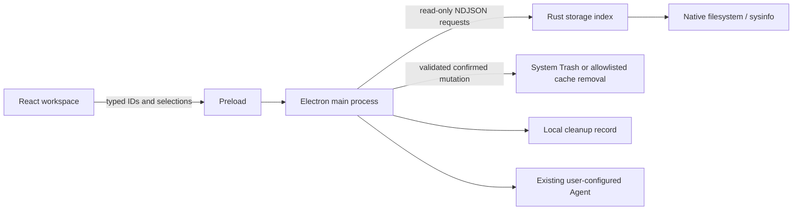

# Cross-platform storage rebuild — 1.0.11

Branch: `rebuild/cross-platform-memento`. The product is organized around freeing storage; process management and the existing user-configured local Agent remain core tools.

## What the MangoDisk research changed

Reference inspected: MangoDisk main `e4d30608faea9527369ee678e6d8ca9a9e1c3688`, release v2.1.1. Its Tauri 2 / Rust / Vue stack separates native storage work from the presentation layer. Useful techniques include bulk directory metadata on macOS, bounded workers, shared navigation/index queries, and staged content hashing. Its user-facing structure puts large files, duplicates, disk analysis, privacy and app associations in clear separate flows. Its homepage makes the outcome of cleaning visible.

Sources: [repository](https://github.com/harry0703/MangoDisk), [release](https://github.com/harry0703/MangoDisk/releases/tag/v2.1.1), [cleanup rules](https://github.com/harry0703/MangoDisk/blob/main/src-tauri/crates/mangodisk-core/rules/README.md), [official site](https://mangodisk.app/zh).

The old Memento homepage concentrated on hardware metrics. It had no dedicated large-file or duplicate flow, a column-only disk browser, no separate privacy module, and bundle-only app removal. Project discovery also exhausted a 160-directory budget before later project roots were reached. Those product and implementation weaknesses motivated this rebuild. The legacy project-discovery budget now accurately names visited directories and allows 20,000; it remains depth-bounded and is used only by the retained macOS Agent evidence scanner.

No source or assets were copied from the GPL project into Memento's MIT codebase. The new native engine, metadata parser, binary treemap and product UI are independent implementations.

## Architecture decision

Keep Electron / React / TypeScript for the desktop boundary, encrypted provider store, AI SDK and safe Agent runtime. Introduce Rust where filesystem work actually happens. A Tauri migration by itself would not make filesystem traversal faster and would require replacing the working Node model integrations. Electron memory/package footprint remains larger than a system-webview shell; this release prioritizes scan latency and coherent product flows over installer size.

`native/` owns traversal, metadata, aggregation, large-file queries and duplicate hashing. Each scan purpose (large files, duplicates, analysis) retains its own long-lived sidecar and index. Filtering and directory queries reuse the matching session. Switching pages preserves results, filters, selections and directory position. Rescanning replaces only that purpose after success; cancelling a replacement keeps the previous session. At most four Rayon workers read metadata/hash content. Queries return 100 large files or 200 directory entries at a time. Progress is throttled; cancellation terminates only the active read-only sidecar. The two-million-entry cutoff is removed. Compact records store parent/name and numeric identities; full paths are reconstructed only for I/O and visible results. Linked child indexes avoid whole-index navigation queries; a deque avoids shifting the traversal queue. Large-file and duplicate scans retain only directories and eligible file candidates; skipped small-file sizes still contribute to directory totals. Only multiply linked files enter the physical-alias set. Indexes are memory-resident, never silently reused across app restarts, and reconciled after confirmed mutations: successful paths are removed with stable IDs and corrected ancestor totals; other results remain queryable.

macOS uses the `getattrlistbulk` ABI defined by Apple's SDK `sys/attr.h`: aligned 64 KiB buffers, bounds-checked records and native metadata. A filesystem or record that cannot supply those attributes falls back to standard traversal. Tests compare size, allocation, identity and timestamps against ordinary metadata and reject truncated/corrupt records. Windows retrieves volume/file identity and link counts through `GetFileInformationByHandle`; Windows reparse/offline/recall attributes are excluded. Unix uses device/inode/link counts; mount crossings, symlinks and macOS dataless cloud files are skipped. The engine does not initiate cloud hydration intentionally. Windows allocation sizes are logical estimates; sparse/compressed sizes and APFS clone/snapshot sharing limit reclaim estimates.

Duplicate scans default to and enforce a minimum of files ≥10 MiB at the product IPC boundary: equal length, three 16 KiB samples, then complete BLAKE3 with 1 MiB reads. All three file workspaces scan the system drive, with no folder picker. All file workspaces exclude hidden descendant directories and application data by default; users can opt in with an explanation of extra scan time and data risks. macOS excludes home Library, /Library and /System/Library; Windows excludes home AppData, configured roaming/local data and ProgramData; Linux skips hidden configuration/data/cache roots. Native exclusions are canonicalized, including temporary-directory aliases. Retained indexes store the actual include option. Space totals reflect the selected scope. UI settings are passed to native traversal. A bounded in-session identity/size/mtime hash cache speeds repeat queries; no hashes persist across app restarts. Files modified within four seconds (or dated in the future) bypass cache reads to handle coarse filesystem clocks; tests rewrite equal-size content while restoring its exact timestamp. Discovery checks descriptor metadata without repeatedly statting all ancestors; mutation bypasses caches and preserves full path validation. Hash progress reports completed/total files at 120 ms intervals. Full hashes run only for sample collisions. The main process rejects deletion of every copy in any selected group and rehashes every survivor and selected copy before moving any file in the whole batch. A shared bottom action bar reviews cross-group selections, count/size and group count in one confirmation; large-file, cache/privacy actions use the same bar. The AI task launcher avoids the bottom actions. A separate test puts a difference outside every sample and verifies that full hashing rejects it.

## Product design

Warm neutral surfaces, forest-green actions, consistent Lucide icons, restrained color accents and a persistent grouped sidebar. No full-home scan on launch. Homepage presents a weighted health score from available CPU/GPU/memory/storage/battery readings (missing measurements excluded), live CPU/memory sample charts and storage capacity. Cards enter CPU/memory descending user-process lists or large files. Scoring explains its load/capacity limits. Immediate total organized bytes, a 14-day cumulative line and daily bars show per-day task counts. The cumulative line includes lifetime activity before the displayed window. The full local ledger is retained; only successful item bytes count. Trash remains distinct from permanent cleanup and is never described as freed disk space. File, duplicate, directory, cleanup/privacy path and application association rows expose registered Show in folder and metadata-based Ask AI with a return to their source page. Cleanup animates actual completed-item counts and current paths, then returns to the remaining results; failed selections remain reviewable. Detailed lists start with no selection; clear review dialogs explain permanent cache removal versus reversible Trash operations. System/application-data paths cannot be removed through large-file browsing. The directory tree is on the left and the treemap on the right, with breadcrumb return paths. System-drive analysis includes Users and ordinary APFS firmlinks, avoids System/Volumes alias traversal and counts directory identities once. Large files have file-type filters; duplicates expand type → group → copies; privacy expands browser → profile → record → paths; the application manager lives under Utilities, hides system applications by default and shows real OS logos, measured sizes, true usage metadata (without mtime substitution), search/sort, unused/update filters, Open, Update and Ask AI. Inline uninstall details label rebuildable versus personal data and permit registered child inspection/selection. The complete app bundle remains required; overlapping parent/child jobs count once. Process rows restore lazy logos, sortable name/PID/CPU/memory headers, user/system scope and inline actions. Help is a small transparent glyph only where its explanation is useful; Overview, Applications, Processes, History and Space explorer omit redundant help. Space explorer has an explicit parent button, preserves proportional area and lists all visible-index children that cannot fit readable labels, including children outside the first 24 chart cells. Reduced-motion preferences and keyboard focus/dialog trapping are supported. Layouts are checked at 1440×900, 1024×768, 820×1180 and 390×844.

## Capability matrix

| Capability | macOS | Windows | Linux |
| --- | --- | --- | --- |
| Home / persistent cleanup history | Implemented | Implemented | Implemented |
| Directory index / large files / treemap | Bulk metadata + fallback | Native traversal / file IDs | Native traversal / inode IDs |
| Duplicate content verification | Implemented | Implemented | Implemented |
| Personal files to system Trash | Electron shell | Electron shell | Desktop Trash service required |
| Cache rules | npm/Yarn/Gradle/Cargo/pip/Homebrew/Xcode/browser/logs | npm/Yarn/Gradle/Cargo/pip/browser | npm/Yarn/Gradle/Cargo/pip/browser |
| Privacy | Safari/Chrome/Edge default history | Chrome/Edge default history | Chrome/Chromium history / recent documents |
| App inventory | Bundles in application roots | Uninstall registry entries | Desktop application entries |
| Application management | Local metadata, Open, Homebrew/App Store/Sparkle updates, bundle + selected registered descendants to Trash | Opens Windows Apps & Features | Opens OS software manager via AppStream |
| App associations | Exact bundle ID + explicit product mapping; no shared groups | System uninstaller owns data decisions | System package manager owns data decisions |
| Live process metrics / user process control | Existing native OS integration | Rust sysinfo | Rust sysinfo |
| Existing configurable AI and provider encryption | Preserved | Preserved + portable evidence | Preserved + portable evidence |
| Terminal / startup/service internals | Preserved | Not offered as native fixes | Not offered as native fixes |
| Local runtime validation in this work | Verified x64 | Compile check only | CI configured, not run locally |

Platform packaging is configured for x64 and arm64 on all three systems. `beforePack` compiles the Rust binary for the **package architecture**, and resources contain the matching executable and `source-revision.json`. CI runs native tests, JS tests, a production build, native smoke and real Electron smoke on three operating systems. Release collection now expects all six platform/architecture jobs, eight installers and the corresponding update payloads/manifests, with eight installer hashes. No public release was requested or published during this rebuild.

Windows verification runs the portable product tests; seven retained macOS maintenance test files (Finder Trash fallback, Homebrew, legacy `du`, hidden-home maintenance, privileged AppleScript, shell environment and launch services) run on the POSIX runners. Mac application-root classification and POSIX permission-bit assertions are also platform scoped. AI encryption, provider editing, path evidence, native indexing and real Trash operations remain covered on Windows. Local Agent evidence accepts both home-path separators and inspects the platform's application-data roots.

Windows/Linux package-manager handoff is intentional: deleting installation folders directly would bypass uninstall registrations, services and package databases. Linux requires a desktop handler for `appstream://`; absent handlers report an error instead of claiming success. Browser histories beyond supported default profiles are not yet enumerated. No package-manager removal or Windows/Linux runtime result is claimed as verified by the local macOS session.

## Mutation and recovery boundaries

The Renderer cannot supply a root path for mutation. It can request a system-drive scan, then use numeric entries paired with the matching purpose’s generation. Main validates all IPC schemas, checks index generation and obtains authoritative entries from Rust. File identity, size, timestamp and non-link path components are rechecked. App bundles and related paths are registered in main, with associated data unselected by default. Shared app containers and fuzzy name matches are excluded; explicit known product folders are included only for their exact bundle IDs.

Caches and supported history records are permanently deleted after confirmation. Privacy groups include existing SQLite `-wal`, `-shm` and `-journal` sidecars, and refuse to run while the browser is detected. Files/apps move to Trash through Electron, preserving OS recovery. The main process journals attempted tasks before changes, persists after each item and distinguishes failures. Bytes are processed-content estimates; Trash remains allocated until emptied. Path revalidation narrows races but does not provide a kernel-level transactional Trash operation; Electron's path-based Trash API is the boundary.

The existing macOS Agent scanner remains an on-demand evidence source for service and terminal operations, including provider-specific app-update internals. It is not used for new storage-page scans. The old scanner can take significantly longer than the focused native index; that timing must not be presented as the native storage engine timing.

## Application management — 1.0.9

Application inventory is local and does not wait on update services. Reused deterministic metadata and update adapters live in `scanner.ts`; no old Renderer or hosted services are restored. `StorageService` owns separate application IDs, metadata, update registrations and file snapshots. Portable AI evidence reuses current application/cache registrations so an explanation cannot expire selections in the original page. Check updates queries the existing sources; execution accepts only a registered ID, validates tokens and uses the existing Sparkle identity/signature verifier. External updater handoffs return `opened`, not `updated`. Linux uses registered desktop launch entries/theme icons; Windows uses registered executable icons when available. Missing platform usage data remains unknown.

The uninstall detail reference was inspected from [MangoDisk’s official screenshot](https://assets.mangodisk.app/images/screenshots/zh/light-04-app-uninstaller.jpg?ver=2.1.1). The independent implementation follows the visible path/size/risk labeling idea; no MangoDisk source or assets were incorporated.

## Background work and process controls — 1.0.10

`StorageTaskQueue` serializes storage discovery and mutations FIFO. Progress carries its originating scope; pages show queued state and cancellation targets only their own scope. Pending cancellation removes the job without stopping active work. Job errors do not poison the queue; no navigation waits on a global busy rejection.

`AiTasks.tsx` owns session-local explanation tasks: needs-provider → queued → preparing → running → ready/failed/cancelled. A single explanation starts at a time, duplicate clicks reuse the task, completion events arriving before the start response are buffered, and cancellation signals both preparation and native runs. Asking never changes pages automatically. The panel tracks unread results, shows progress/success on the originating action and supports retry/dismissal. Provider setup retains the source/scroll and saved configuration resumes waiting tasks. Viewing a result retains a return to the source; process filters remain mounted. Completed runs still use the existing history/runtime. A portal tooltip supports pointer hover and keyboard focus without table clipping.

Processes default to user-only, CPU descending; CPU and memory use strict >40% orange / >65% red boundaries. Rows freeze during pointer/focus interaction. macOS `process-control.ts` resolves the owning outer app bundle, terminates all owned bundle processes for force quit, checks UID/path/start identity, protects system/self/ancestor processes and polls actual exit. Normal quit targets main app executables. Restarted/still-running apps report failure. Portable native termination also verifies PID/start-time disappearance. A pinned Dock shortcut can remain after process exit.

## Progressive application inventory — 1.0.11

Startup restores a schema-validated, platform-scoped `application-inventory.json` and starts discovery independently from page navigation. The Renderer subscribes to typed inventory snapshots, shows cached/partial rows immediately and retains them during refresh/failure. macOS inspects metadata in batches of eight without recursive `du` fallback, then measures non-system bundle sizes on a separate sidecar with an eight-second per-bundle timeout. List readiness does not wait on size measurement. Directory/Info.plist identity, modification times and version fingerprint size reuse; unchanged apps are not recursively measured again.

Root watchers debounce install/removal events and a five-minute refresh updates external changes and use metadata. IDs remain stable by location (plus name for shared Windows registry locations). Changes invalidate only their affected update/association registrations; confirmed app removal persists immediately. Disk writes serialize atomic replacement. Persisted records are display data and require live re-registration before Open/Update/Uninstall; cached updater authorizations are never restored. First reads/refreshes coalesce, including startup; an empty or failed cache falls back to discovery with visible retry. Directory watchers are opportunistic, with periodic discovery as fallback. No persistent storage-file index is introduced.

## Languages

`src/shared/localization.ts` owns the locale registry and English fallback; `src/shared/locales/` owns flat message resources. The new workspace uses semantic keys. 584 static/interpolated messages from the existing AI/settings/maintenance views were extracted into catalog keys; dynamic legacy OS diagnostics still use their existing Chinese/English compatibility formatter. The settings selector and `AppLanguage` derive from the registry. Add a language resource, register it and provide matching placeholders; parity tests catch missing keys. Dates/numbers use `Intl`. Any new dynamic diagnostic should use catalog interpolation rather than adding bilingual branches.

## Evidence from this machine

- Native tests: metadata ABI parity, corrupt record rejection, changed-file rejection, hard-link/symlink exclusion, full-hash rejection of sample collisions, projection totals/hidden scope, cached-content invalidation and category/pagination correctness.
- macOS x64 synthetic warm-cache fixture: 20,103 entries (20,000 small files plus directories and two 1 MiB copies). One observed run: standard native enumeration **37 ms**, bulk native enumeration **25 ms**. A previous more loaded run measured 97/66 ms. This is a repeatable local engine comparison, **not** a competitor or whole-disk benchmark. Run `node scripts/native-smoke.mjs` after building.
- Previous 1.0.6 home scan stopped at **2,000,000 entries / 61.4 s**. 1.0.7 full home analysis enumerated **2,131,920 / 60.773 s**, zero errors, 62,013 skipped; no cutoff. This confirms coverage beyond the old cap, not a major full-traversal speedup.
- 1.0.7 focused large-file scope: **525,197 enumerated entries / 8.148 s**, 66,818 retained records, zero errors, 12,004 skipped. Full hidden/app-data coverage requires the visible include option.
- 1.0.7 default duplicate scope: **524,692 enumerated entries**, 76,010 retained records, **9.431 s traversal + 3.240 s content verification = 12.698 s total**; 816 duplicate groups. Repeating the query in the same session took **38 ms**. This uses the exposed ≥200 KB, hidden/app-data exclusions; it is not equivalent to a full-home scan or a controlled competitor benchmark.
- Read-only system-drive analysis enumerated **3,682,623 entries / 99.773 s**, 309 inaccessible directories, 171,706 skipped; no cutoff. **Users was the largest root child (321,970,497,592 logical bytes)**. Full-disk traversal remains materially slower than focused duplicate discovery. APFS sharing and skipped paths limit totals.
- Reproduce read-only workloads with `node scripts/storage-benchmark.mjs <root> analysis|large|duplicates`.
- Existing macOS Agent scan smoke: ~16.4–20.2 seconds on this machine, with valid registered operations and no scan diagnostics. This is broader evidence collection including service, shell and application-update discovery, not a comparable index workload.
- Real Electron smoke: application inventory starts without page navigation, persists and restores stable IDs after restart; cross-group duplicate removal on owned fixtures; concurrent file/privacy discovery queues, owned child process exits through production IPC, actual local metrics/inventory, native index and duplicate grouping; main-process all-copies guard; cancellation; one owned fixture moved to Trash; persisted record; privacy selection; encrypted provider key edit/test/save/reload.
- Browser UI: 48 page captures across four viewports plus cleanup animation/remaining-results flows, retained filters/selections, immediate home totals and charts, AI background/unread/provider-setup/return/cancel/retry flows, duplicate survivor selection, app association selection, process-to-AI flow, English and dark mode. No page errors or horizontal overflow.
- Windows x64 Rust `cargo check` completed locally. Windows/Linux runtime and signed public release remain CI validation boundaries.
